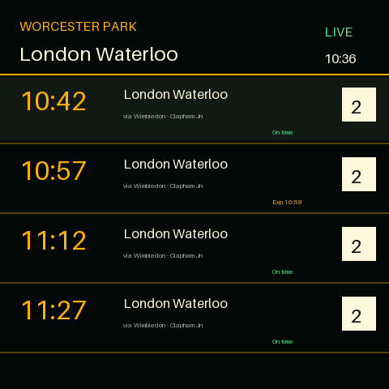
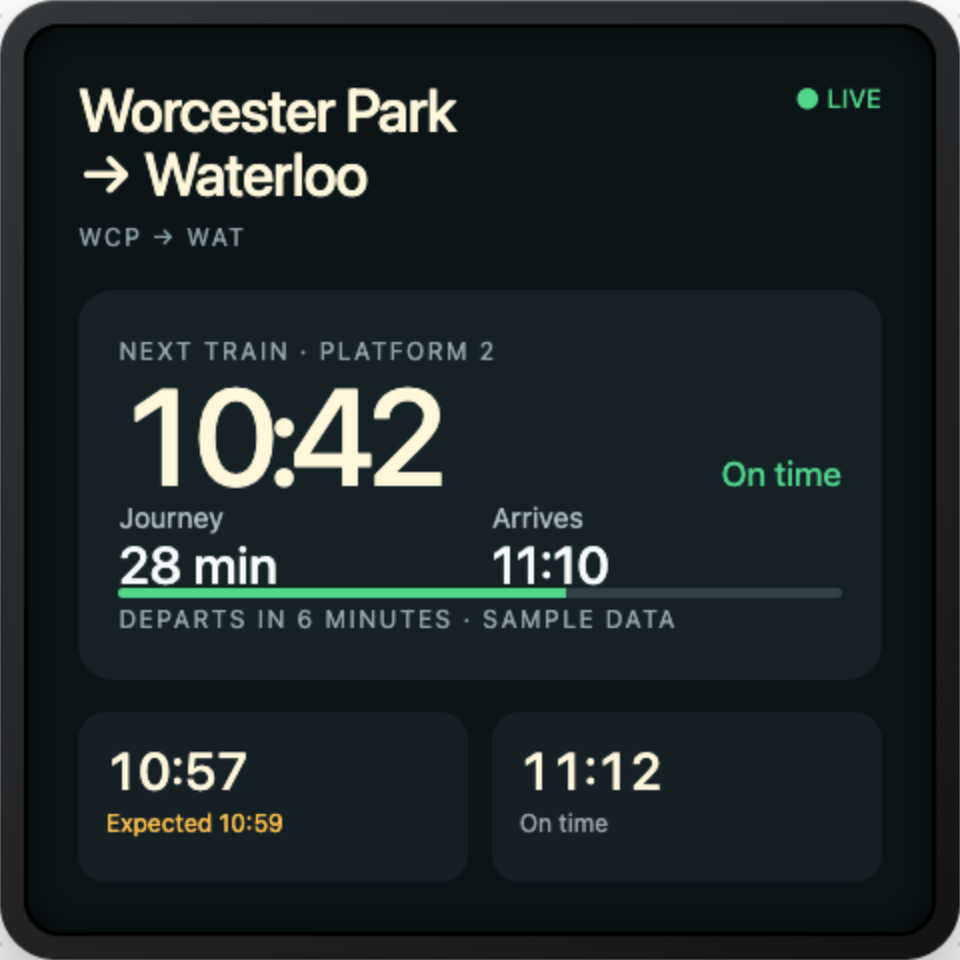

# Pimoroni Presto Train Display

A self-contained MicroPython departure board for Pimoroni Presto, using live
National Rail Darwin data from the Rail Data Marketplace (RDM) JSON API.

## Current status

The first working milestone includes:

- a MicroPython RDM client using HTTPS and the `x-apikey` header;
- flexible Darwin response normalisation for services and calling points;
- a 480×480 platform-style Presto renderer;
- one-minute refreshes, bounded retry backoff and stale-data retention;
- automatic Europe/London daylight-saving conversion;
- configuration and secret templates; and
- host tests plus an on-device display smoke test.

Live requests require an RDM account subscribed to the public Live Departure
Board JSON product. The shared endpoint is included; the account's consumer key
is not.

## Decision summary

Build a self-contained MicroPython application for Pimoroni Presto that renders a
UK platform-style departure board and retrieves live Darwin data directly from
National Rail's Live Departure Board service.

Use the current Rail Data Marketplace (RDM) REST/JSON form of LDBWS as the
primary interface. It returns the same National Rail Darwin departure data as
legacy OpenLDBWS, but avoids running a SOAP client and XML parser on the Presto.
The legacy SOAP service is a fallback only if the RDM product is unavailable to
the account.

The first release should require no Raspberry Pi, server, cloud function, or
JSON translation proxy.

## UI concepts

Two initial 480×480 display concepts for the Worcester Park to London Waterloo
route. The departures shown are illustrative sample data, not live Darwin data.

| Platform board | Journey focus |
|:--:|:--:|
|  |  |

## Configure and test

Create untracked device configuration files:

```sh
cp config.py.example config.py
cp secrets.py.example secrets.py
```

The current shared `RDM_BASE_URL` is already present in `config.py.example`.
Set the Wi-Fi values and the consumer key issued after subscription as
`RDM_CONSUMER_KEY` in `secrets.py`. Do not commit either file. Keep the URL
configurable so it can be updated if RDM publishes a new product path or API
version.

Run the dependency-free host tests:

```sh
python3 -m unittest discover -s tests -v
```

With a Presto connected over USB, preview the renderer directly from the repo
without changing the board's filesystem:

```sh
uvx mpremote connect /dev/cu.usbmodem101 mount . run tools/presto_smoke.py
```

## Install on Presto

Installing this application as `main.py` replaces the stock launcher. Back up
the current launcher first:

```sh
mkdir -p backups
uvx mpremote connect /dev/cu.usbmodem101 fs cp :main.py backups/presto-main.py
```

Then upload the application, support modules and your untracked configuration:

```sh
uvx mpremote connect /dev/cu.usbmodem101 fs cp -r lib :
uvx mpremote connect /dev/cu.usbmodem101 fs cp main.py :main.py
uvx mpremote connect /dev/cu.usbmodem101 fs cp config.py :config.py
uvx mpremote connect /dev/cu.usbmodem101 fs cp secrets.py :secrets.py
uvx mpremote connect /dev/cu.usbmodem101 reset
```

The application keeps the last good board visible when a refresh fails and
marks it stale. It never logs the RDM key or Wi-Fi password.

## References and assumptions

- Presto hardware: <https://shop.pimoroni.com/products/presto>
- Presto firmware and examples: <https://github.com/pimoroni/presto>
- National Rail Darwin feeds: <https://www.nationalrail.co.uk/developers/darwin-data-feeds/>
- Rail Data Marketplace: <https://raildata.org.uk/>
- Reference departure-display implementation: <https://github.com/chrisys/train-departure-display>

Hardware baseline:

- RP2350B, 520 KB SRAM, 8 MB PSRAM and 16 MB flash
- 480×480 colour IPS LCD with capacitive touch
- 2.4 GHz Wi-Fi, seven RGB backlight LEDs and a piezo speaker
- Pimoroni's current Presto MicroPython firmware

National Rail currently states that Darwin SOAP API use is free up to five
million requests per four-week railway period. RDM product terms and the exact
generated endpoint must be checked when subscribing; they remain the source of
truth for the JSON service.

## Product goals

Version 1 will:

1. Show live departures for one configured GB station.
2. Recreate the visual hierarchy of a UK platform display: departure time,
   destination, live status, platform and calling points.
3. Refresh once per minute without blocking the display between refreshes.
4. Continue showing the last good board when Wi-Fi or the API is unavailable,
   with an obvious data-age/stale indicator.
5. Keep the National Rail API key and Wi-Fi password outside tracked source.
6. Run entirely on the Presto using the supported MicroPython firmware.

Version 1 will not be a journey planner, ticketing application, historical data
store, multi-device service, or safety-critical passenger-information system.

## User experience

### Default board

Use a black background with amber/yellow type and rules. Take advantage of the
larger square screen without turning the display into a generic table:

- Header: station name, `Departures`, connection state and local clock.
- Primary service: large departure time and destination, prominent live status,
  and a high-contrast platform box.
- Calling points: one or two lines that scroll only when the text does not fit.
- Following services: three or four compact rows with time, destination, status
  and platform.
- Footer: National Rail attribution plus `Updated N min ago` when appropriate.

Status presentation:

- `On time`: amber/yellow.
- Delay or revised time: red/orange accent while retaining readable text.
- Cancelled: red accent and `Cancelled`; never replace it with an ambiguous time.
- Platform unavailable: `–`, not a guessed value.
- Platform alteration: highlight the platform box when the API exposes enough
  information to identify the change.

### Touch interactions

Keep touch optional so the device remains useful as an always-on sign:

- Tap the primary service to switch between calling points and service details.
- Tap the connection/data-age indicator to retry immediately.
- A later release may add swipeable stations or on-device configuration; neither
  is required for version 1.

### Device states

Define and design these explicitly rather than showing raw exceptions:

- Starting and connecting to Wi-Fi
- Loading the first board
- Live board
- Live board with no departures
- Stale cached board
- Configuration error (missing station or key)
- API/authentication error
- Wi-Fi unavailable

The RGB LEDs and speaker should be off by default. A later opt-in feature may use
the LEDs for disruption state; routine refreshes must not make sounds.

## Data access

### Account setup

1. Register at <https://raildata.org.uk/>.
2. Open the public
   [Live Departure Board product](https://raildata.org.uk/dashboard/dataProduct/P-d81d6eaf-8060-4467-a339-1c833e50cbbe/overview),
   select **Subscribe**, and accept the current terms.
3. Wait for the subscription to show as **Active**. Key provisioning can take about
   a minute after approval.
4. Open the product's **Specification** tab and copy the **Consumer key** shown
   under **API access credentials**.
5. Put the key in the untracked `secrets.py` as `RDM_CONSUMER_KEY`. Never commit
   or share this value.

The current shared product base URL is:

```text
https://api1.raildata.org.uk/1010-live-departure-board-dep1_2/LDBWS/api/20220120
```

It is not account-specific. Store it in configuration so a future product or
version change does not require application-code changes.

### Request

Use the JSON equivalent of `GetDepBoardWithDetails` so calling points arrive in
the same request as the board:

```text
GET {LDBWS_BASE_URL}/GetDepBoardWithDetails/{CRS}?numRows=10&timeWindow=120
x-apikey: {RDM_CONSUMER_KEY}
```

Optional destination filtering can later add `filterCrs` and `filterType=to`.
Station codes and query values must be validated before building the URL.

Start with ten rows and measure the response on real hardware. Reduce the row
count if peak memory is unsafe. Close every HTTP response promptly and release
the raw payload after normalisation.

### Normalised model

Isolate the RDM response schema from the renderer. Convert each service into a
small dictionary containing only:

- service identifier
- scheduled and estimated departure times
- destination(s)
- platform and platform-suppression state
- operator
- cancellation state and reason
- delay reason
- calling points, including scheduled/estimated times when present

Treat absent objects, singleton-versus-list variations, `null`, `Delayed`,
`Cancelled` and missing platforms as normal input cases. Store a captured,
redacted response as a test fixture only after confirming that its licence
permits repository publication.

### Refresh and failure policy

- Normal refresh: 60 seconds.
- Use `time.ticks_ms()`/`ticks_diff()` for scheduling, not long blocking sleeps.
- On failure, retain the last successful normalised board and mark it stale.
- Retry with bounded backoff: 60 seconds, 2 minutes, then 5 minutes.
- Reconnect Wi-Fi before retrying when the interface has disconnected.
- Do not write every response to internal flash. Keep the working cache in RAM;
  optional SD-card persistence can be considered later.
- Reject implausible or malformed responses rather than replacing good cached
  data with an empty board.

One request per minute is about 40,320 requests per four-week period, comfortably
below National Rail's published SOAP allowance. The subscribed RDM JSON product
terms must still be checked independently.

## Repository layout

```text
.
├── main.py                  # Application loop and state transitions
├── config.py.example        # Non-secret station/display settings
├── secrets.py.example       # Names of required secret values, no real values
├── lib/
│   ├── rail_api.py          # HTTPS request and RDM authentication
│   ├── departures.py        # Response normalisation and filtering
│   ├── board_view.py        # 480×480 platform-style renderer
│   ├── uk_time.py           # Clock and Europe/London DST handling
│   └── app_state.py         # Refresh, retry and stale-data state
├── docs/
│   ├── home-assistant.md    # Optional future Home Assistant provider
│   └── images/              # UI concepts and screenshots
├── tests/
│   ├── fixtures/            # Redacted API responses
│   ├── test_departures.py
│   ├── test_rail_api.py
│   ├── test_uk_time.py
│   └── test_app_state.py
├── tools/presto_smoke.py    # On-device renderer smoke test
└── README.md
```

Prefer small modules with no CPython-only dependencies. Core parsing and state
logic should remain importable under CPython for fast tests, while display and
network adapters are exercised on the device.

## Configuration and security

`config.py` should contain non-secret settings such as:

- departure station CRS code
- optional destination CRS filter
- refresh interval
- number of services shown
- operating/display-brightness hours
- RDM base URL

`secrets.py` should contain Wi-Fi credentials and the RDM consumer key. Both the
real `config.py` and `secrets.py` should be ignored by Git, with safe example
files committed.

Security requirements:

- HTTPS only; never fall back to plaintext HTTP.
- Verify on hardware that the current firmware validates the server certificate.
  Do not silently disable certificate validation to get a prototype working.
- Send the consumer key only in the `x-apikey` header.
- Never print secrets, request headers, or a credential-bearing command.
- Do not expose credentials through touch screens or diagnostic messages.
- Validate the station code as three ASCII letters and URL-encode all optional
  query values.

## Time handling

Departure times returned by LDBWS are passenger-facing local times and should be
displayed as supplied. For the header clock:

1. Synchronise the RTC using NTP after Wi-Fi connects.
2. Convert UTC using a tested Europe/London daylight-saving helper (last Sunday
   of March through last Sunday of October).
3. Resynchronise periodically and after reconnecting.

Do not rely on a permanently configured UTC offset, which would be wrong for
half the year.

## Memory and performance spike

Before building the complete UI, make the first milestone a device experiment:

1. Connect with `Presto.connect()` using an untracked `secrets.py`.
2. Perform one authenticated HTTPS request with `urequests`.
3. Record free memory before download, after download, after JSON parsing and
   after normalisation/garbage collection.
4. Verify certificate behaviour and response-close behaviour.
5. Render a diagnostic summary while Wi-Fi remains connected.

Target at least 100 KB of free heap after a complete fetch/parse/render cycle.
If the full response cannot be handled reliably:

1. reduce `numRows`;
2. remove the details/calling-points variant;
3. introduce a small streaming JSON parser; then
4. only as a last resort, add a separately deployable SOAP/JSON bridge.

The bridge is deliberately last because it adds another service, credential
boundary and failure mode to what should be a standalone desktop display.

## Optional future Home Assistant source

Users who already run Home Assistant could optionally read departure data from
the [`homeassistant_nationalrail`](https://github.com/darrenparkinson/homeassistant_nationalrail)
sensor instead of having Presto call RDM directly. This is a future extension,
not a version 1 dependency: the default installation remains self-contained and
requires no Raspberry Pi, Home Assistant instance or translation proxy.

The proposed adapter and its security, configuration and data-mapping boundaries
are documented in [Home Assistant data source](docs/home-assistant.md).

## Testing strategy

### Host tests

- Parse normal, delayed, cancelled and no-service fixtures.
- Handle singleton and list variants in the SOAP-derived JSON shape.
- Handle hidden/missing platforms and multiple destinations.
- Check long-name truncation and scrolling calculations independently of the
  physical screen.
- Test retry/backoff and stale-age transitions with a fake clock.
- Test UK DST boundaries for several years.
- Ensure configuration validation rejects malformed station codes and unsafe
  endpoint schemes.

### Device tests

- Cold boot with valid and invalid credentials.
- Wi-Fi loss during a request and between requests.
- API 401/403, 429 and 5xx responses.
- Multi-hour run with heap measurements to detect leaks.
- Long destinations/calling-point lists and large disruption messages.
- Touch while fetching and while text is scrolling.
- Screen readability at minimum/maximum ambient brightness.

Tests must mock network calls by default; automated tests must not consume the
live API allowance or require a real consumer key.

## Delivery milestones

### Milestone 0 — feasibility spike

- Confirm HTTPS, authentication, JSON parsing and memory headroom on Presto.
- Save a redacted response shape for parser development if licensing permits.
- Decide whether ten detailed rows are safe.

Exit criterion: repeated requests complete without a crash, leak or disabled TLS
verification.

### Milestone 1 — data client

- Add validated configuration and ignored secrets.
- Implement RDM client, normalisation, error classification and host tests.
- Implement NTP and Europe/London clock handling.

Exit criterion: normalised departures are correct for on-time, delayed,
cancelled, filtered and no-service responses.

### Milestone 2 — display

- Build static 480×480 layouts for all application states.
- Add text measurement, truncation and calling-point scrolling.
- Add National Rail attribution in accordance with the subscribed terms.

Exit criterion: every fixture renders legibly without overlap or off-screen
content.

### Milestone 3 — resilient application

- Join fetch scheduling, cached data, retry policy and display animation.
- Add reconnect logic, stale indication and immediate touch retry.
- Run an overnight soak test.

Exit criterion: loss and restoration of Wi-Fi/API service require no reboot and
never erase a valid cached board.

### Milestone 4 — documentation and release

- Document RDM subscription, configuration, firmware and file upload steps.
- Add screenshots, troubleshooting and credential-rotation instructions.
- Choose and add an explicit software licence; audit every font/image licence.
- Tag the first tested release.

## Version 1 acceptance criteria

- A new user can configure Wi-Fi, an RDM key and a CRS code without editing
  application logic.
- The board updates at least every 90 seconds during normal operation.
- Time, destination, status and platform agree with the corresponding National
  Rail departure board for tested services.
- Delayed and cancelled trains cannot appear as `On time`.
- A failed refresh leaves the last valid board visible and reports its age.
- No credential is committed, logged, displayed or placed in a URL.
- The device survives a 12-hour soak test with stable memory usage.
- National Rail attribution and data use comply with the accepted RDM terms.

## Open questions to resolve during Milestone 0

1. Does the shipping Presto firmware validate the RDM TLS certificate chain, and
   how are CA updates handled?
2. What is peak heap usage for ten `GetDepBoardWithDetails` rows?
3. Which font can provide the desired UK dot-matrix character while permitting
   redistribution?
4. Does the subscribed product require a particular attribution asset or wording
   on a 480×480 physical display?
