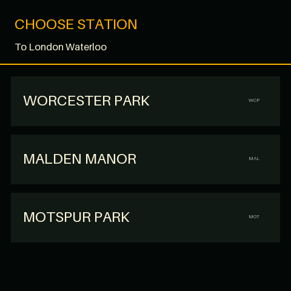

# Pimoroni Presto Train Display

A self-contained live UK departure board for
[Pimoroni Presto](https://shop.pimoroni.com/products/presto). It connects
directly to National Rail Darwin through the Rail Data Marketplace (RDM)
REST/JSON API—no Raspberry Pi, server, cloud function or translation proxy is
required.

## What it does

- Starts with a touch picker for Worcester Park, Malden Manor, Motspur Park or
  New Malden.
- Shows the next four direct services to London Waterloo.
- Displays scheduled time, live status, platform and calling points.
- Opens a Journey focus screen when a departure is tapped.
- Shows journey duration, arrival time and a live departure countdown.
- Refreshes every minute and retains the last valid board after a failed update.
- Handles UK daylight-saving time automatically.
- Can boot directly into the app or run from Presto's demo carousel.

## Screenshots

These screenshots are generated directly through the current application
renderer using representative Darwin data.

| Station picker | Departure board | Journey focus |
|:--:|:--:|:--:|
|  |  |  |

## Requirements

- Pimoroni Presto with current MicroPython firmware
- Wi-Fi network
- Rail Data Marketplace account and Live Departure Board subscription
- Python 3 for host tests
- [`mpremote`](https://docs.micropython.org/en/latest/reference/mpremote.html)
  for installation over USB

## Get an RDM consumer key

1. Create an account at [Rail Data Marketplace](https://raildata.org.uk/).
2. Subscribe to the **Live Departure Board** REST/JSON product.
3. Open the product in your dashboard and wait for the consumer key to appear;
   provisioning can take a minute after the account is approved.
4. Copy the key into `secrets.py` as `RDM_CONSUMER_KEY`.

The API URL is shared rather than account-specific and is already defined in
`config.py.example`. Keep it configurable in case RDM changes the product path.
The legacy SOAP service is not used.

## Configure

Create local configuration files:

```sh
cp config.py.example config.py
cp secrets.py.example secrets.py
```

Edit `secrets.py`:

```python
WIFI_SSID = "your-network-name"
WIFI_PASSWORD = "your-network-password"
RDM_CONSUMER_KEY = "your-rdm-consumer-key"
```

`config.py` contains the station list, Waterloo destination filter, RDM URL,
refresh interval and screen brightness. Both real configuration files are
ignored by Git; never commit credentials.

## Install: direct boot

Connect the Presto over USB and identify its serial device, then upload the app:

```sh
uvx mpremote connect /dev/cu.usbmodem1101 fs cp -r lib :
uvx mpremote connect /dev/cu.usbmodem1101 fs cp main.py :main.py
uvx mpremote connect /dev/cu.usbmodem1101 fs cp config.py :config.py
uvx mpremote connect /dev/cu.usbmodem1101 fs cp secrets.py :secrets.py
uvx mpremote connect /dev/cu.usbmodem1101 reset
```

Replacing `main.py` makes the station picker appear whenever the Presto starts.
Back up the stock launcher first if you may want to restore the carousel:

```sh
uvx mpremote connect /dev/cu.usbmodem1101 fs cp :main.py backups/presto-main.py
```

## Install: demo carousel

Keep the stock `main.py` and upload `train_display.py` instead:

```sh
uvx mpremote connect /dev/cu.usbmodem1101 fs cp -r lib :
uvx mpremote connect /dev/cu.usbmodem1101 fs cp train_display.py :train_display.py
uvx mpremote connect /dev/cu.usbmodem1101 fs cp config.py :config.py
uvx mpremote connect /dev/cu.usbmodem1101 fs cp secrets.py :secrets.py
uvx mpremote connect /dev/cu.usbmodem1101 reset
```

The stock launcher discovers **Train display** and gives it the built-in travel
icon.

## Use

1. Tap a station on the launch screen.
2. Tap any displayed departure to open Journey focus.
3. Tap Journey focus to return to the departure board.
4. Reset the Presto to restart the app and choose another station.

## Develop and test

Run the dependency-free host test suite:

```sh
python3 -m unittest discover -s tests -v
```

Preview the board renderer on a connected Presto without installing files:

```sh
uvx mpremote connect /dev/cu.usbmodem1101 mount . run tools/presto_smoke.py
```

README screenshots use Pillow and can be regenerated after UI changes:

```sh
python3 tools/render_readme_screenshots.py
```

## Project layout

```text
main.py                 Direct-boot entry point
train_display.py        Stock-carousel entry point
lib/train_app.py        App state, touch handling and live refresh loop
lib/board_view.py       480×480 station, board and focus renderers
lib/rail_api.py         RDM HTTPS client
lib/departures.py       Darwin response normalization
lib/uk_time.py          Europe/London clock conversion
config.py.example       Non-secret settings template
secrets.py.example      Credential template
tests/                  Host test suite and sample Darwin response
tools/                  On-device smoke test and screenshot renderer
```

## Optional Home Assistant source

A future extension could read National Rail data from
[`darrenparkinson/homeassistant_nationalrail`](https://github.com/darrenparkinson/homeassistant_nationalrail)
for users who already run Home Assistant. Direct RDM remains the implemented
and default source. See [docs/home-assistant.md](docs/home-assistant.md).

## Data source

Departure information comes from National Rail Darwin via the RDM Live
Departure Board product. Live accuracy, availability and product terms remain
the responsibility of the data provider.
